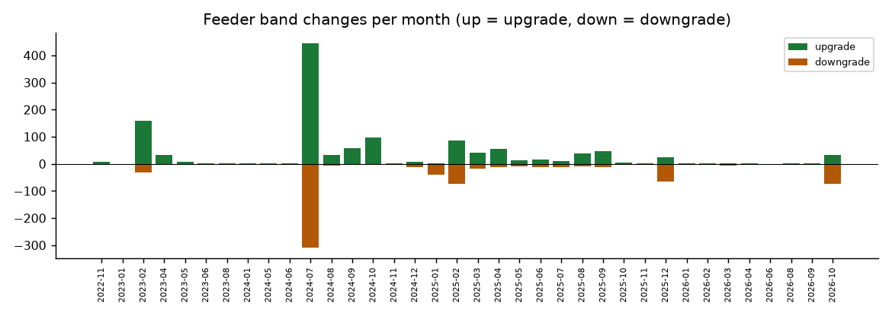
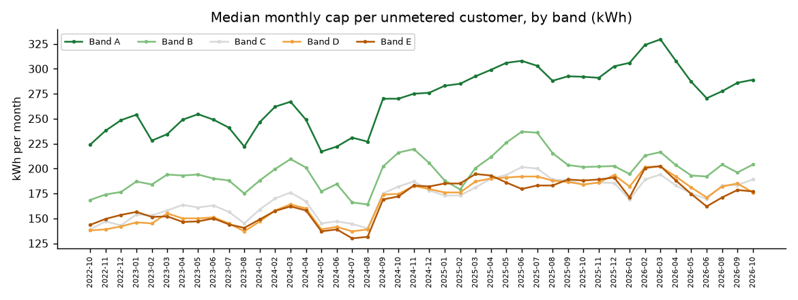
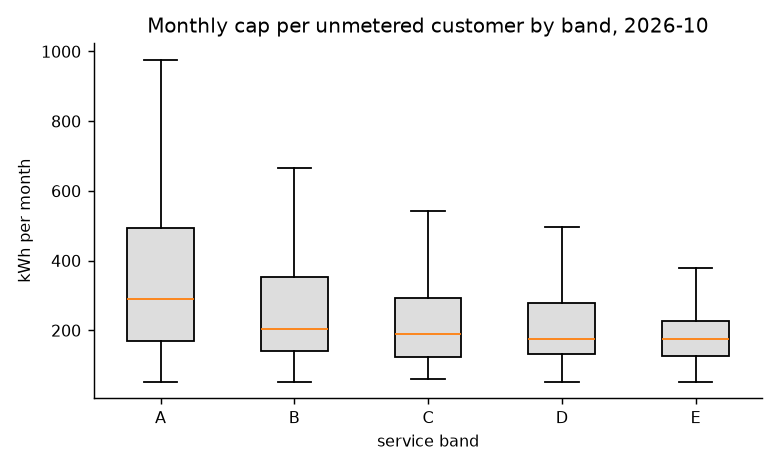
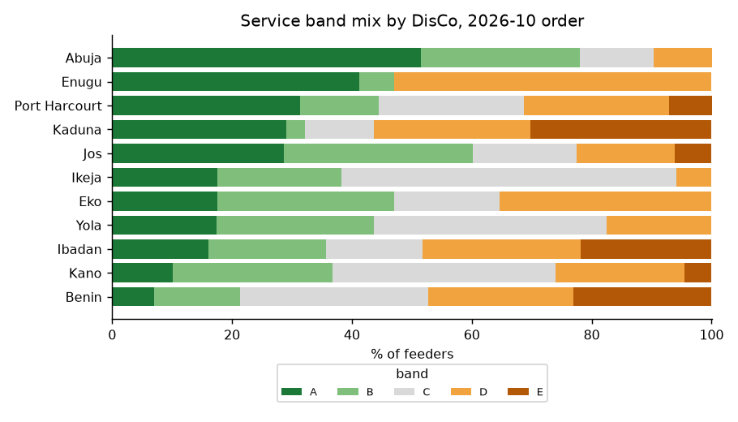
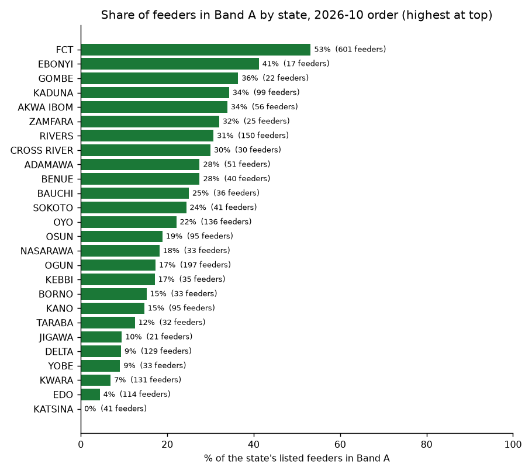
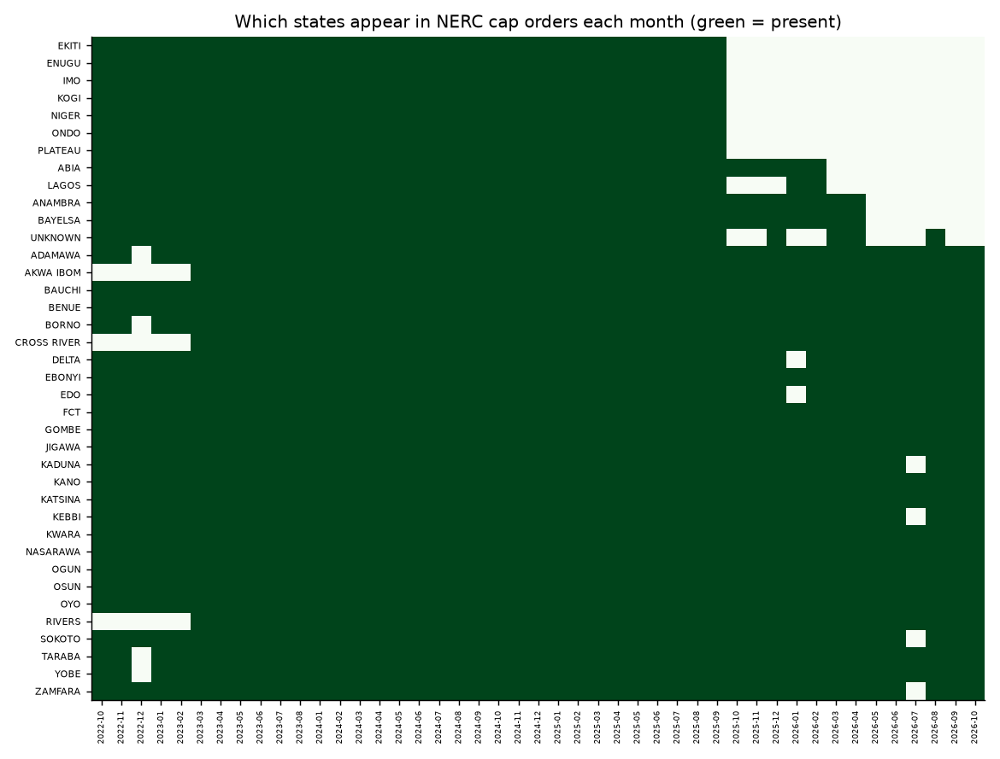

# What four years of NERC energy cap orders show

Analysis of every Monthly Energy Cap order the Nigerian Electricity Regulatory Commission (NERC) has published online, October 2022 to October 2026. Every number below is computed by `scripts/analyze.py` from the tables in `data/`, and is stored in `data/findings.json`.

## The data in one paragraph

Since 2022, NERC has published a monthly order for each distribution company (DisCo) that lists every feeder with unmetered customers, the feeder's service band (A to E), and the maximum kWh a DisCo may bill an unmetered customer on that feeder that month (Order NERC/307/2022). Band A carries a promise of at least 20 hours of supply a day; bands B to E promise progressively fewer. We collected 523 of these orders, extracted 147,815 feeder-month records covering 6,309 distinct feeders across 45 months, and linked each feeder across time.

| | |
|---|---|
| Orders (PDFs) | 523, all 11 DisCos plus Aba Power |
| Months covered | 45, October 2022 to October 2026 |
| Feeder-month records | 147,815 |
| Distinct feeders | 6,309 |
| Caps set by state regulators (Lagos and Enugu, July to October 2026) | 2,366 records, 593 feeders |
| Feeders in the latest order (October 2026) | 2,295 |
| State identified | 99.4 percent of records |

---

## Key findings

### 1. The biggest re-banding happened in July 2024

The July 2024 orders changed the band of 755 feeders in a single month, 445 upgrades and 310 downgrades. No other month comes close: the next largest are February 2023 (192 changes) and February 2025 (160).

The most common single move was Band A to Band B (186 feeders). Among the states that are still in NERC's orders today, the share of feeders in Band A fell from 29.6 percent in June 2024 to 24.1 percent in July 2024, while Band B rose from 12.1 to 18.7 percent. This followed NERC's April 2024 decision to charge Band A customers a much higher tariff than other bands, which put the 20-hour promise under scrutiny. Band A has since recovered to 28.1 percent.

Over the whole record, 584 feeders moved into Band A and 495 moved out of it.

### 2. Caps per unmetered customer have risen by about 30 percent

The median monthly cap, for states that are in the orders at both ends of the period, rose from 158 kWh in October 2022 to 205 kWh in October 2026. For Band A feeders it rose from 224 to 289 kWh; for Band E from 143.5 to 177 kWh. Because caps are derived from what metered neighbours on the same feeder actually consume, a higher cap means either more supply or more consumption on that feeder, and a higher maximum bill for unmetered households.

### 3. Caps follow bands at the top, but not at the bottom

In the October 2026 orders the median cap is 289 kWh for Band A, 204 for B, 189 for C, 176 for D and 177 for E. Band A is clearly higher, but Bands D and E are indistinguishable. A band is a promise of hours; a cap is a measure of consumption. The two diverge at the bottom.

101 feeders in Bands D or E have a cap above their own DisCo's Band A median. Ibadan (37), Kaduna (24) and Port Harcourt (22) account for most of them; the highest is a Band D feeder in Delta (Benin DisCo) capped at 908 kWh, nearly double Benin's Band A median of 478 kWh. These are the feeders where a low supply promise sits next to a high billing ceiling, and they are listed in `data/rankings/anomaly_low_band_high_cap_latest.csv`.

### 4. Abuja has the most Band A feeders; Benin and Kano the fewest

Share of each DisCo's listed feeders in Band A, October 2026 order, highest to lowest:

| DisCo | Feeders listed | Band A | Band E | Median cap (kWh) |
|---|---:|---:|---:|---:|
| Abuja | 635 | 51.5% | 0.0% | 260 |
| Enugu (Ebonyi only) | 17 | 41.2% | 0.0% | 127 |
| Port Harcourt | 236 | 31.4% | 7.2% | 390 |
| Kaduna | 199 | 29.1% | 30.2% | 121 |
| Jos | 98 | 28.6% | 6.1% | 126.5 |
| Ikeja (Ogun only) | 34 | 17.6% | 0.0% | 362 |
| Eko (Ogun only) | 17 | 17.6% | 0.0% | 289 |
| Yola | 149 | 17.4% | 0.0% | 139 |
| Ibadan | 509 | 16.1% | 21.8% | 192 |
| Kano | 158 | 10.1% | 4.4% | 176 |
| Benin | 243 | 7.0% | 23.0% | 300 |

Kaduna is the most polarised: 29.1 percent of its feeders in Band A and 30.2 percent in Band E. It also re-banded 106 feeders in the October 2026 order alone (73 down, 33 up), and has the most downgrades of any DisCo over four years (159). Yola has the worst net record, with 119 downgrades against 37 upgrades.

By state (at least 10 feeders listed), the FCT leads with 53 percent of feeders in Band A. Katsina has none, Edo 4 percent, Kwara 7 percent, and Delta, Yobe and Jigawa about 9 percent.

### 5. Seventeen states have taken over regulation; NERC's orders track it unevenly

Under the Electricity Act 2023, NERC has issued transfer orders to 17 states (table in `data/reference/state_regulators.csv`, with the order number, date and source for each). Comparing those orders with what NERC actually published:

- **Eleven states dropped out of NERC's cap orders, all of them late.** Ekiti, Enugu and Ondo had transfer deadlines in October 2024 but stayed in NERC's orders until September 2025, eleven months later. Imo, Kogi, Niger and Plateau also left in September 2025. Lagos (deadline June 2025) stayed until February 2026, having disappeared in late 2025 and reappeared in January and February 2026. Abia, Bayelsa and Anambra left in February to April 2026.
- **Six transferred states are still in NERC's orders.** Oyo and Edo (deadlines February 2025), Ogun (June 2025), Nasarawa (February 2026) and Gombe (July 2026) are all past their transfer deadlines but still listed in the October 2026 orders. Akwa Ibom is still within its transition period.
- **The Ibadan footprint is shrinking inside the same states.** In the same states, NERC listed 861 Ibadan feeders in October 2025 and 509 in October 2026.

For anyone living in Lagos, Enugu, Imo, Ondo, Ekiti, Kogi, Niger, Plateau, Abia, Bayelsa or Anambra, the federal cap no longer appears in NERC's orders. Only two of those state regulators publish caps of their own, Lagos and Enugu (section 7). The other nine publish no caps, bands or tariff orders (checked 26 October 2026; what was checked is in `data/reference/state_regulators.csv`). Ekiti follows NERC's tariffs by interim order and Anambra has adopted NERC's instruments by order; Abia's regulator website could not be checked.

### 6. Most feeders keep their band

Of the 3,896 feeders listed for at least a year, 62.8 percent never changed band and only 1.7 percent changed three times or more. The most changes by any feeder is five: Kaduna's Gwari Avenue feeder (between A and D, over 42 months) and Ubakala in Abia (between A and C, over 37 months). Band changes come in waves, such as July 2024, not as constant churn. The full list is in `data/rankings/most_volatile_feeders.csv`.

---

### 7. Lagos and Enugu set their own caps, and they are lower

Two state regulators publish monthly caps: the Lagos State Electricity Regulatory Commission (LASERC) for the two Lagos successor companies (IE Energy Lagos and Excel Electricity Distribution, the former Ikeja and Eko networks), and the Enugu Electricity Regulatory Commission (EERC) for MainPower. Both are in the dataset from July to October 2026, with a `regulator` column, and each feeder is linked to its NERC history.

- **Lagos.** LASERC's files list 519 feeders in October 2026 and print a band for each. 496 of them link to a feeder in NERC's orders, and every one of those has the same band NERC last gave it. LASERC lists older files back to October 2025, but its storage now refuses them and no archive has copies, so March to June 2026 is a gap for Lagos.
- **Enugu.** EERC lists 73 feeders, 70 of which link to NERC's history. Its files print no band, so the dataset carries each feeder's last NERC band, flags it in `band_source`, and leaves those rows out of band statistics. Under Order EERC/2026/001, EERC sets each cap from the feeder's average metered consumption with outliers removed, plus 15 percent. From October 2024 to May 2026 EERC had adopted NERC's caps by order.

Caps follow consumption and move with the seasons, so the fair comparison is the same feeder twelve months earlier, when NERC still set its cap. From July to September 2026, the median Enugu cap was 21.5 to 32.5 percent lower than a year before, and the median Lagos cap 11.4 to 15.6 percent lower. Over the same months, caps in the states NERC still covers fell by 3.5 to 10.9 percent. Lagos's caps fell a little faster than the national trend; Enugu's new method cut them by about a quarter. The month-by-month figures are in `data/summary/state_vs_nerc_year_on_year.csv`.

### 8. What the caps mean in naira

A cap is in kWh; a bill is in naira. Multiplying each feeder's cap by the regulator's allowed tariff for its band (Non-MD class, the class the caps apply to) and adding 7.5 percent VAT gives the most an unmetered customer on that feeder can legally be billed for the month. The tariffs were read, value by value, from NERC's MYTO 2024 orders and September 2026 supplementary orders for all eleven DisCos, and from LASERC's and EERC's own orders; they are in `data/reference/tariffs_non_md.csv` with the order, table and page for each.

In the October 2026 orders the median maximum legal bill is about ₦65,086 for a Band A feeder, against ₦14,676 for Band B, ₦10,763 for C, ₦6,556 for D and ₦6,281 for E. The gap comes from the tariff more than the cap: Band A pays 209.50 naira a kWh, Bands B to E between about 31 and 69, frozen since December 2022. Among DisCos, the median Band A maximum ranges from ₦31,980 (Enugu, Ebonyi feeders only) to ₦138,844 (Ikeja, Ogun feeders only). The figures per DisCo and band are in `data/summary/max_bill_by_disco_band_latest.csv`.

Every month from December 2022 is priced; October and November 2022 are not, because the December 2022 tariff review that set the rates before it was never published. Enugu's rows are not priced, because EERC prints no bands and a carried band may no longer be right. EERC's own records show MainPower billing Band A at 209.50 naira a kWh instead of the 160.40 its order allows.

### 9. Finding a feeder by street

Every tariff order has an appendix that lists each feeder with its location and the major streets it serves. From the September 2026 orders (LASERC for Lagos, NERC for every other DisCo and Ogun), 2,800 feeder listings are in `data/reference/feeder_areas.csv`; 1,735 of them are linked to 1,723 feeders in the cap data. A listing is linked only when the names match exactly, by a DisCo's own code scheme, or closely with every number and distinguishing word equal; the rest stay unlinked rather than risk pointing a reader to the wrong feeder, and are still searchable by street on the lookup page.

## How the data was built

1. **Collection.** NERC's document library was searched year by year and page by page. 22 files that timed out were fetched again; one (Ikeja, December 2022) is a dead link on NERC's own site. NERC has not put January to September 2022 or September to December 2023 online.
2. **Extraction.** 415 orders have a text layer and were read with pypdf in layout mode, which keeps the table columns apart. 108 orders from November 2025 to August 2026 are scanned images; they were read with Apple's Vision text recognition, one table row at a time, placing every word in its column from the table's ruling lines. The recognised text of every scanned page is committed in `raw/ocr_text/` so it can be checked and never needs to be re-run.
3. **Month.** Each order's month is read from its own title, with the file name as fallback. Two files disagree with themselves: a Kano order named January 2024 whose title says January 2025, and an Enugu order named January 2025 whose title still says January 2024 (its caps match December 2024 and February 2025, not early 2024). Each is placed in the month where that DisCo has no other order; both land in January 2025, and the decision is logged in `data/parsed/reparse_qa.log`.
4. **Feeder identity.** A feeder is matched across months by its DisCo and a stable form of its name (voltage tags, "FEEDER", case and punctuation removed), which links the same feeder through renames such as FESTAC 2, AJELE FESTAC 2 and AJELE 33kV-FESTAC 2. Where that stable name would merge two different feeders in the same month, the full printed name, business unit and position in the order are used instead. 500 scanned records were linked to their feeder by close-name matching (similarity at least 0.88) and are flagged `fuzzy_ocr`.
5. **State.** The orders only print a state column from 2025. For earlier orders, state is learned from the business unit using the later orders (68.0 percent of records), or taken from a hand-written map of business units to states (9.6 percent, in `data/reference/bu_state_manual.csv`). 21.8 percent have the state printed; 0.6 percent remain unknown.
6. **Wrapped names.** When a feeder name is too long for its cell, the PDF text puts the rest on the line below the row (for example AT6_SULEJA, then TOWNSHIP_S3_HASSANDALATU). A line with text only in the feeder column, straight after a row, is joined to that row's name. Ikeja's `A - Bilateral` band cells are read as Band A.
7. **Cleaning.** 645 rows that NERC printed twice in the same order were removed.

## Limitations

- **Scanned months are less certain.** For November 2025 to August 2026, band letters that Apple Vision skips when read alone are re-read in the context of their whole row; 18 records still have a band that could not be read and are marked `?`; they are excluded from band statistics. Month to month, the share of a month's feeders that are linked to the previous month (within the same DisCo and state) has a median of 98.9 percent for text months (lowest 81.9, January to February 2023) and 90.8 percent for scanned months (82.6 to 93.7).
- **Coverage is not jurisdiction.** A state's presence in NERC's orders is what NERC published, not a legal statement of who regulates it.
- **Caps are not bills.** A cap is the legal maximum for an unmetered customer, not what anyone was actually billed. The dataset says nothing about metered customers.
- **Naira figures are an upper bound for one class.** They use the Non-MD allowed tariff and 7.5 percent VAT (VAT as reported in the press, not stated in the orders). Lifeline (50 kWh or less) and maximum-demand customers pay other rates.
- **Gaps.** No orders for January to September 2022 or September to December 2023 are online; December 2022 lacks Ikeja.
- **Business unit names are as printed.** In older orders, some feeder-name fragments appear in the business unit column; they are kept as printed and flagged where the state could not be inferred.

## Files

| File | What it holds |
|---|---|
| `data/clean/caps_long.csv` | One row per feeder per month: the main table |
| `data/clean/feeders.csv` | One row per feeder: first and last month seen, latest band and cap, best and worst band, number of band changes |
| `data/clean/band_history_wide.csv` | Feeders down, months across, band letters; opens well in Excel |
| `data/summary/` | Coverage by month, DisCo and state by month, the like-for-like trend, every band change, state jurisdiction |
| `data/rankings/` | Latest-month rankings, highest to lowest |
| `data/reference/state_regulators.csv` | The 17 state transfer orders, with sources |
| `data/parsed/` | The raw extraction, one file per month, before cleaning |
| `data/parsed/sources.csv` | Every source PDF with its URL file name, SHA-256, pages, rows and extraction method |
